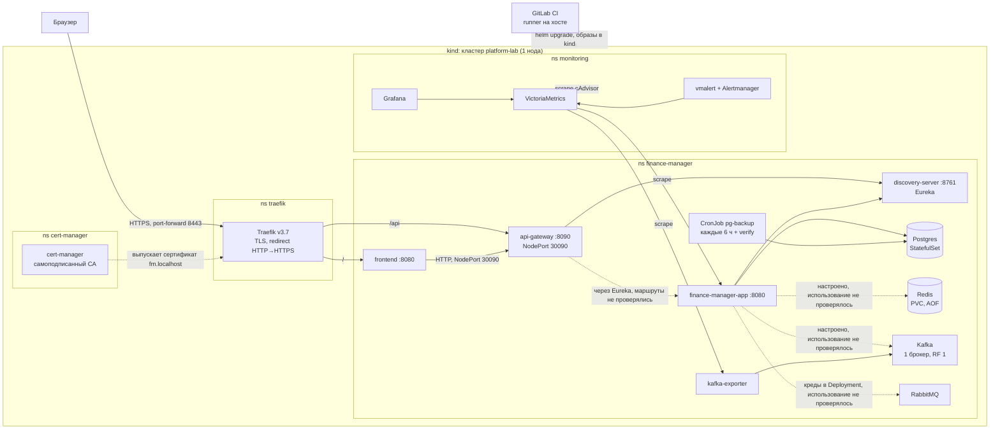
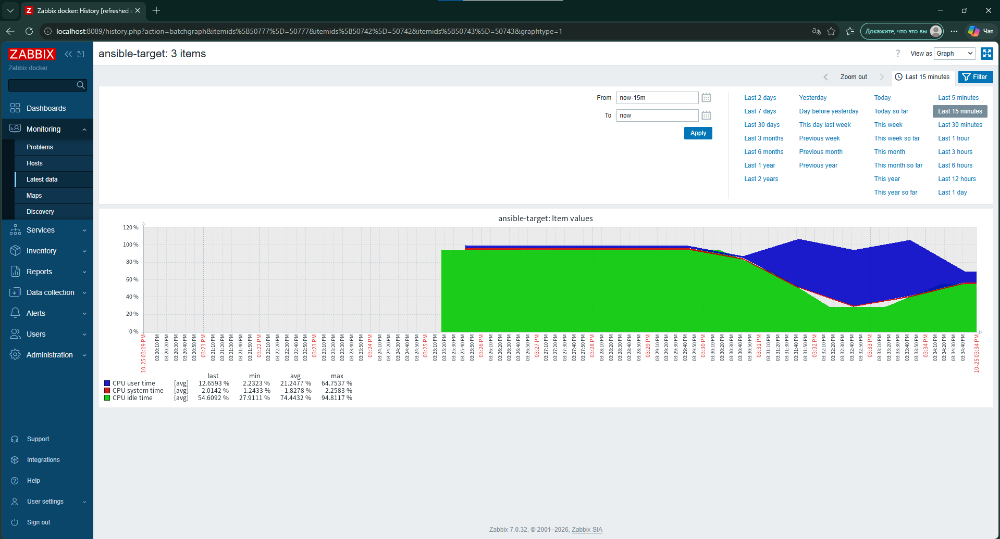
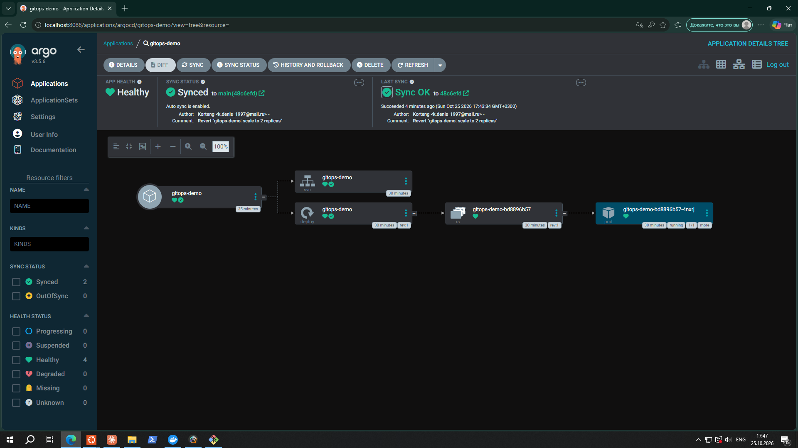

# platform-lab

Инфраструктурный проект: эксплуатация микросервисного приложения [Finance Manager](https://github.com/Korteng/finance-manager) (Java/Spring Boot, Kafka, RabbitMQ, Redis, PostgreSQL, Eureka, Spring Cloud Gateway, Camunda 7) как платформы. Код приложения здесь не дублируется, берётся из соседней папки.

В kind развёрнуты discovery-server, finance-manager-app, api-gateway и frontend плюс инфраструктура (Postgres, Redis, RabbitMQ, Kafka). notification-service, camunda-service и python-observer запускаются только через compose (профили).

Цель: пройти путь Java-разработчика к Platform/DevOps на реальном стеке: контейнеризация, Kubernetes + Helm, CI/CD (GitLab CI), Ansible, observability, эксплуатация БД и брокеров.

## Архитектура



Что подтверждено на кластере: маршруты Ingress (`/` в frontend, `/api` в gateway), регистрация gateway и app в Eureka, креды Postgres в app, сервисы и порты. Пунктиром отмечено то, что настроено (общий ConfigMap `fm-config` подключён ко всем четырём сервисам), но фактическое использование не проверялось: Redis, Kafka и RabbitMQ со стороны приложения, маршрутизация gateway на app. На схеме нет Loki и Vector (развёрнуты в W5, сейчас отключены для экономии памяти) и compose-варианта запуска. notification-service, camunda-service и python-observer в кластере не развёрнуты.

## Статус

| Этап | Содержание | Статус |
|---|---|---|
| W1 | Docker: общий Dockerfile, healthcheck, лимиты, compose с профилями | готово |
| W2 | kind + Helm-чарты, HPA, Ingress (Traefik), metrics-server, откат через --atomic | готово |
| W3 | GitLab CI (свой runner): lint автоматически, build и deploy в kind вручную (кнопка) | готово |
| W4 | Ansible: роли base, tools, nginx (reverse proxy + кэш), zabbix_agent, идемпотентный прогон на SSH-цели | готово |
| W5 | Observability: VictoriaMetrics, Grafana, Loki/Vector (сейчас отключены для экономии памяти), алерты, runbook | готово |
| W6 | Postgres backup (ручной и по расписанию с проверкой восстановления), Redis AOF, Kafka basics, TLS (cert-manager), 4 postmortem, диаграмма | готово |
| Zabbix | Zabbix server + агент (Ansible-роль), мониторинг хоста | готово |
| ArgoCD | GitOps: Argo CD ведёт демо-чарт из Git (auto-sync, selfHeal, откат через git revert) | готово |

## Быстрый старт

Нужно: Docker с Compose v2 и BuildKit, GNU Make (в WSL2 Ubuntu есть из коробки), исходники Finance Manager рядом (`../finance-manager`).

```bash
cp .env.example .env     # поменяй пароли и APP_JWT_SECRET
make up                  # ядро: БД, Kafka, RabbitMQ, Redis, Eureka, app, gateway, frontend
make up PROFILES="notifications"            # + notification-service и его БД
make up PROFILES="notifications bpm observability"   # всё
make ps                  # состояние и health
make stats               # память и CPU по контейнерам
make down
```

Фронтенд: http://localhost:3001, API gateway: http://localhost:8090, Eureka: http://localhost:8761.

## Профили (под слабое железо)

| Профиль | Что добавляет | Зачем отдельно |
|---|---|---|
| (по умолчанию) | postgres, redis, rabbitmq, kafka, discovery-server, app, api-gateway, frontend | минимальный рабочий стек |
| `notifications` | notification-service + БД | Kafka consumer, не нужен для всех сценариев |
| `bpm` | camunda-service + БД | тяжёлый (Camunda), включать по необходимости |
| `observability` | python-observer, Prometheus, Grafana | замеры и дашборды |

Лимиты памяти заданы в `compose.yaml` (`mem_limit`), JVM берёт долю от лимита (`-XX:MaxRAMPercentage=75`).

## Что сделано в W1

- Один общий `docker/java-service.Dockerfile` на все Java-сервисы вместо пяти копий: multi-stage, BuildKit-кэш Maven, non-root, `HEALTHCHECK` на actuator, `ExitOnOutOfMemoryError`.
- Фронтенд на `nginx-unprivileged` (не root, порт 8080).
- `docker compose` с профилями, `depends_on: service_healthy`, лимитами памяти.
- `Makefile` с командами для повседневной работы.

## Результаты замеров W1 (десктоп: 3 ядра, 8 ГБ ОЗУ, WSL2, Docker Desktop)

Ядро (8 контейнеров, без профилей):

| Сервис | Память (факт / лимит) |
|---|---|
| fm-app | 392 МиБ / 512 МиБ |
| fm-kafka | 329 МиБ / 768 МиБ |
| fm-gateway | 206 МиБ / 384 МиБ |
| fm-discovery | 202 МиБ / 384 МиБ |
| fm-rabbitmq | 122 МиБ / 384 МиБ |
| fm-postgres | 62 МиБ / 256 МиБ |
| fm-redis | 13 МиБ / 64 МиБ |
| fm-frontend | 7 МиБ / 64 МиБ |
| **Итого** | **~1.3 ГиБ** |

- Размеры образов: app 699 МБ, discovery 538 МБ, gateway 518 МБ, frontend 74 МБ.
- Холодная сборка всех образов: ~445 с (из них ~390 с первая загрузка Maven-зависимостей; повторная сборка использует BuildKit-кэш).
- Старт `fm-app` под нагрузкой одновременного подъёма стека: ~110 с, healthcheck настроен с запасом (`start_period` 120 с).
- RabbitMQ на этой машине стартует ~49 с, Kafka ~40+ с: `start_period` увеличен до 90 с (первая версия с 20 с ложно помечала RabbitMQ как unhealthy).
- Приёмка: `make up` поднимает ядро одной командой, сквозной сценарий (регистрация, транзакция, бюджет через gateway) проверен в браузере.

## Известные ограничения (задел на следующие этапы)

- (закрыто в W2) В `discovery-server` и `api-gateway` добавлен `spring-boot-starter-actuator`, healthcheck теперь штатный `/actuator/health`, включены liveness/readiness-пробы.
- Образы тяжёлые (500-700 МБ на Java-сервис): кандидаты на оптимизацию, слоёный jar (`layertools`), JRE alpine/jlink. Исходные образы до рефакторинга не замерялись, сравнения «до/после» нет.
- `fm-app` использует 76% лимита 512 МиБ: при росте нагрузки лимит поднять.
- Секреты в `.env`, в K8s они создаются командой `make k-secrets` как Secret `fm-secrets` (W2, сделано).

## W2: Kubernetes (kind + Helm)

Кластер: kind, одна нода. Два Helm-чарта: `infra` (Postgres, Redis, RabbitMQ, Kafka) и `finance-manager` (discovery-server, finance-manager-app, api-gateway, frontend). Секреты `fm-secrets` создаются из `.env` командой `make k-secrets`, в чартах их нет.

Запуск: `make k-up k-load k-secrets k-infra`, затем `make k-deploy`. Сервисы поднимаются после инфры, не одновременно.

### Что проверено

| Проверка | Результат |
|---|---|
| Убить под `finance-manager-app` | ReplicaSet пересоздал под, снова `1/1` примерно через минуту (старт JVM 32 с). Простой на одной реплике |
| Убить `postgres-0` | Данные на месте (PVC), `finance-manager-app` без рестартов |
| HPA (`finance-manager-app`, CPU 70%, min 1, max 2) | Под нагрузкой 1 -> 2 реплики примерно за 30 с. После нагрузки возврат к 1 через ~5 минут |
| Нагрузка `POST /api/auth/login`, 10 клиентов, 90 с | 1465 ответов, все 200, 16.2 req/s, p50 0.55 с, p95 1.16 с, p99 1.48 с |
| Релиз с несуществующим тегом образа | Новые поды в `ErrImagePull`, старые `1/1`, приложение отвечало. `helm rollback` вернул рабочую ревизию без перезапуска старых подов |
| `helm upgrade --atomic --timeout 5m` | Сломанный релиз откатывается автоматически (ревизия `failed`, затем `Rollback`) |
| Ingress (Traefik) | `/` -> frontend, `/api` -> api-gateway, хост `fm.localhost` |

### Нюансы и ограничения

- Нагрузка по эндпоинту логина (BCrypt) это CPU-bound замер, а не типичная нагрузка. Генератор и кластер на одной машине (3 ядра, WSL 4 ГБ). Это не сравнение 1 и 2 реплик.
- HPA упёрся в `maxReplicas: 2` (ограничение по RAM), цель 70% при пике достигнута не была.
- У `finance-manager-app` нет `limits.cpu`: под может занять всё CPU ноды.
- metrics-server запущен с `--kubelet-insecure-tls` (kind использует самоподписанный сертификат kubelet). Только для лаборатории.
- ingress-nginx выведен из эксплуатации в марте 2026, поэтому выбран Traefik. Сервис Traefik типа `ClusterIP`, на хосте порты 80/443 в kind не проброшены, доступ через `kubectl port-forward svc/traefik 8080:80`.
- Фронт обращается к gateway напрямую (NodePort 30090), а не через `/api` Ingress.
- Первая попытка на ноуте (2 ядра, ~6 ГБ) давала шторм рестартов: дефолтные пробы с `timeoutSeconds: 1` убивали поды под нагрузкой CPU. Таймауты пробов увеличены, лаборатория перенесена на десктоп (3 ядра, 8 ГБ): 0 рестартов.

## W3: CI/CD (GitLab CI, свой runner)

Пайплайн `.gitlab-ci.yml`, runner в Docker (`gitlab/gitlab-runner`, executor `docker`) на рабочей машине, Docker хоста монтируется через `docker.sock`.

| Стадия | Job | Что делает |
|---|---|---|
| lint | `helm-lint` | `helm lint` чартов `infra` и `finance-manager` |
| lint | `hadolint` | проверка Dockerfile (порог `error`) |
| build | `build-images` (вручную) | `make build`: клонирует `finance-manager`, собирает 4 образа, кэш Maven в BuildKit cache mount |
| deploy | `deploy-kind` (вручную) | тегирует образы коммитом, загружает в ноду kind, `helm upgrade --atomic --timeout 10m` |

### Как устроен деплой
- Job подключается к сети `kind`, берёт `admin.conf` из ноды, образы импортируются в containerd ноды (как `kind load`), релиз обновляется с `image.tag=<короткий SHA коммита>`.
- Секреты в пайплайне не создаются: `make k-secrets` в CI перезаписал бы реальные пароли плейсхолдерами из `.env.example`. `fm-secrets` создаётся один раз вручную.

### Что сломалось по дороге
- Первые job'ы ушли на общие runner GitLab (нет доступа к Docker хоста: `tcp://docker:2375`). Исправление: отключены instance runners для проекта.
- Повторный `git clone` в `build-images` падал: рабочая папка runner сохраняется между запусками. Исправление: `rm -rf ../finance-manager` перед клоном.
- `docker network connect kind "$(hostname)"` не находил контейнер (hostname не равен имени контейнера). Исправление: ID контейнера из `/proc/self/mountinfo`.
- Деплой падал по таймауту и откатывался (ревизии 8-9 `failed`): rolling update поднимал новые JVM рядом со старыми, память WSL (4 ГБ) уходила в swap, API-сервер кластера отвечал `TLS handshake timeout`. Исправление: `maxSurge: 0, maxUnavailable: 1`, WSL 5 ГБ, `--timeout 10m`. `--atomic` откатил релиз без ручных действий.

### Ограничения
- Runner с `docker.sock` получает полный контроль над Docker хоста: подходит только для личной лаборатории и собственного кода.
- Сборка и деплой запускаются вручную (кнопка в GitLab), кластер должен быть запущен.
- `maxUnavailable: 1` допускает короткий простой при обновлении (одна реплика на сервис).
- Предупреждения hadolint (DL3025, DL3022, DL3066) не чинились, порог пайплайна `error`.

## W4: Ansible (подготовка хоста)

Роли `base`, `tools`, `nginx` и `zabbix_agent` настраивают Linux-хост по SSH. Цель: контейнер `ansible-target` (Ubuntu 24.04 + sshd, лимит 256 МБ). Control node: WSL Ubuntu, ansible-core 2.20.1.

| Команда | Что делает |
|---|---|
| `make a-build` | собирает образ цели |
| `make a-target` | запускает контейнер-цель (порт 2222) |
| `make a-ping` | проверка связи |
| `make a-run` | применяет плейбук |
| `make a-check` | режим проверки с diff |
| `make a-nginx` | применяет только роль `nginx` (тег) |
| `make a-zabbix` | применяет только роль `zabbix_agent` (тег) |

### Что делают роли
- `base`: базовые пакеты, рабочий каталог `/opt/platform-lab`.
- `tools`: kubectl v1.37.1, helm v3.22.1, kind v0.33.0 с версией в имени файла, симлинки в `/usr/local/bin`, проверка checksum с официальных источников, повторы при сетевых сбоях.
- `nginx`: reverse proxy с кэшем (`proxy_cache`, зона 10 МБ, TTL 200-ответов 30 с), заголовок `X-Cache-Status`, `/healthz`, gzip. Конфиг из шаблона, проверка `nginx -t` до запуска. Апстрим задаётся переменной `nginx_upstream`; по умолчанию поднимается локальный origin на 127.0.0.1:8081, отдающий текущее время (по нему видно, что ответ пришёл из кэша). В контейнере нет init, поэтому nginx стартует командой с защитой `pgrep -x nginx`, а handler делает `nginx -s reload` только если процесс жив.
- `zabbix_agent`: см. раздел [Zabbix](#zabbix-мониторинг-хоста).

### Результат
- Первый прогон: `changed`, повторный: `changed=0`.
- `--check --diff`: без изменений, версии инструментов видны.
- `nginx`: первый прогон `changed=5`, повторный `changed=0`, задача старта пропускается.
- Кэш проверен запросами к контейнеру: первый `MISS`, второй `HIT` с тем же временем origin; через 31 с `EXPIRED` и новое время; `/healthz` отвечает `ok`.

### Что сломалось по дороге
- Скачивание kubectl упало (`Incomplete read`): добавлены `retries` и `until`.
- `ansible.cfg` в `/mnt/c` игнорируется (права 777): конфиг подключается через `ANSIBLE_CONFIG` в Makefile.
- Контейнер-цель остановился после перезапуска Docker: `make a-target` его поднимает.
- В `--check` пропускалась проверка версий: добавлен `check_mode: false` для чтения.

### Ограничения
- Цель это контейнер, а не сам WSL-хост, systemd и демон Docker в нём не настраиваются.
- Ключ без пароля, `host_key_checking = False`: только для лаборатории.
- `nginx`: один апстрим без балансировки, без TLS, TTL кэша фиксирован; origin это заглушка для проверки кэша. Процесс не под супервизором: если nginx упал, повторный прогон роли поднимет его.

## W5: Observability

Метрики, дашборд и алерты для приложения в kind. Всё описано кодом в `monitoring/`, чарты запинены.

| Компонент | Версия чарта | Назначение |
|---|---|---|
| VictoriaMetrics single | vm/victoria-metrics-single 0.49.0 | хранение метрик, scrape (retention 7d, PV 2Gi) |
| Grafana | grafana/grafana 10.5.15 | дашборд, datasource и дашборд провижинятся из ConfigMap |
| vmalert + Alertmanager | vm/victoria-metrics-alert 0.51.0 | правила, получатель `devnull` |
| Loki | grafana/loki 7.5.0 | логи, SingleBinary, PV 2Gi, retention 48h |
| Vector | vector/vector 0.60.0 | DaemonSet, читает логи подов `finance-manager`, шлёт в Loki |
| Kafka exporter | prometheus-community/prometheus-kafka-exporter 4.1.0 | метрики lag consumer group, ставится в `finance-manager` |

Источники метрик: сама VictoriaMetrics, `finance-manager-app` (`/actuator/prometheus`), cAdvisor через API server (ClusterRole в `monitoring/rbac-cadvisor.yaml`). Интервал scrape 30s, окно rate 2m.

### Логи

Vector (DaemonSet, `kubernetes_logs`) собирает логи подов namespace `finance-manager` и отправляет в Loki с метками `namespace`, `pod`, `container`. В Grafana datasource Loki подключён провижинингом, смотреть в Explore: `{namespace="finance-manager", container="finance-manager-app"}`.

### Алерты

Описаны в `monitoring/vmalert-values.yaml`, разбор в [docs/runbooks.md](docs/runbooks.md): `AppDown`, `PodRestarted`, `High5xxRate`, `HighMemory`, `KafkaConsumerLag`.

### Результат

- Все 3 target в состоянии `up`, дашборд на 7 панелей собирается из `monitoring/dashboards/finance-manager.json`.
- Тест сбоя: `postgres` масштабирован в 0, запросы к `/actuator/health` дали 503, `High5xxRate` перешёл в `firing`. После возврата реплики алерт гаснет.
- Попутно `PodRestarted` сработал на пересозданный `postgres-0`: рестарт БД тоже виден.

- Тест `KafkaConsumerLag`: в приложении нет живого консюмера, поэтому проверено синтетически. Отдельный топик `lag-test`, группа `lag-test-group` прочитала 1 сообщение, затем в топик записано ещё 3 без консюмера, lag стал 3, алерт перешёл в `active`. После чтения хвоста алерт гаснет.

### Что нашлось по дороге

- Readiness probe приложения не включает БД: при остановленном postgres под остаётся `Ready`, а `/actuator/health` отдаёт 503. Трафик продолжает идти на неработающий под. Исправление (probe с учётом БД) не сделано.
- cAdvisor отвечал 403: не хватало прав на `nodes/proxy`, добавлены ClusterRole и Binding.
- HPA после рестартов кратко поднимается до 2 реплик и возвращается к 1.
- Loki падал с `mkdir /var/loki: read-only file system`: без PV чарт не монтирует каталог данных при read-only корне. Включён PV 2Gi, отключён sidecar правил.
- Vector: Service с `spec.ports: Required value` (портов у агента нет) и `{{ }}` в labels воспринимались как шаблон Helm. Исправлено `service.enabled: false` и экранированием в `monitoring/vector-values.yaml`.
- Kafka объявляет себя коротким именем `kafka`, из namespace `monitoring` оно не резолвится (`lookup kafka ... server misbehaving`), scrape экспортёра падал по таймауту. Экспортёр перенесён в `finance-manager`.

### Ограничения

- kube-state-metrics не установлен, рестарты оцениваются через `changes(container_start_time_seconds)` за 10m.
- Алерт по lag проверен только синтетической группой, реального консюмера в деплое нет. Порог `> 0` для лаборатории.
- Логи только namespace `finance-manager`, хранятся 48h, алертов по логам нет.
- Alertmanager без реальных уведомлений, получатель `devnull`.
- Доступ к UI через `kubectl port-forward`, ingress не настроен.

## W6: операции с данными

### Postgres backup/restore

Логический бэкап `pg_dump -Fc` из пода `postgres-0`, восстановление `pg_restore --clean --if-exists --no-owner`. Скрипты в `scripts/`, цели Makefile: `make pg-backup`, `make pg-break`, `make pg-restore`. Пароли в скриптах не фигурируют: `psql` и `pg_dump` берут пользователя и БД из переменных окружения внутри пода.

- `pg-backup`: дамп в `backups/` (в `.gitignore`), рядом `.sha256` и `.counts` (число строк по таблицам на момент дампа).
- `pg-break`: `TRUNCATE "transaction", budget` имитирует потерю данных.
- `pg-restore`: проверка контрольной суммы, восстановление из последнего дампа, сверка счётчиков с `.counts`.

Результат прогона: до потери `budget` 1, `transaction` 1; после `pg-break` 0 и 0; после `pg-restore` 1 и 1, счётчики совпали с дампом.

### Ограничения

- В базе по одной строке в `budget` и `transaction`: механизм доказан, объём и время восстановления не измерялись.
- Бэкап ручной, локальный, без расписания, без копии вне машины, без PITR.
- Потеря имитирована удалением строк, не потерей тома. Восстановление выполнено в ту же БД при работающем приложении, проверка дампа в отдельной БД не делалась.

### Redis persistence

Redis переведён с Deployment на StatefulSet (`charts/infra/templates/redis.yaml`) с PVC 1Gi (`data-redis-0`) на `/data` и включённым AOF: `--appendonly yes --appendfsync everysec`. Размер тома задаётся `redis.storage` в `charts/infra/values.yaml`.

Проверка до изменения (Deployment без тома): ключ записан, `redis-cli save`, под удалён, после пересоздания ключа нет.

Проверка после изменения:

- `set persist:test after-change`, `kubectl delete pod redis-0`: ключ на месте.
- `set persist:hard still-here`, `kubectl delete pod redis-0 --grace-period=0 --force`: оба ключа на месте.

### Ограничения Redis

- Жёсткое убийство проверено через несколько секунд после записи: окно `appendfsync everysec` (до 1 секунды потерянных записей) не проверялось.
- Приложение сейчас не хранит ключи в Redis (`dbsize 0`), тест выполнен на тестовых ключах.
- Один экземпляр, без репликации и Sentinel, том на `standard` StorageClass kind (локальный диск ноды), бэкапа тома нет.
- Лимит памяти пода 64Mi остался прежним: на больших данных переписывание AOF может упереться в него.

### Postgres: бэкап по расписанию и проверка восстановления

CronJob `pg-backup` в чарте `infra` (`charts/infra/templates/postgres-backup.yaml`, параметры `pgBackup.*` в `values.yaml`): раз в 6 часов `pg_dump -Fc` базы Finance в PVC `pg-backups` (1Gi), контрольная сумма, хранение последних 5 копий. Учётные данные берутся из Secret через `secretKeyRef`, в чарте паролей нет.

В самом задании дамп сразу восстанавливается во временную БД `fm_verify`, число строк в `app_user`, `budget`, `category`, `transaction` сверяется с боевой БД, затем `fm_verify` удаляется. При расхождении задание завершается с ошибкой.

Проверка: ручной запуск `kubectl create job --from=cronjob/pg-backup pg-backup-manual`, в логах `VERIFY OK`, счётчики `1|1|4|1`, `BACKUP OK`.

Находка: PVC `pg-backups` остаётся `Pending` до появления pod'а (StorageClass `standard` в kind использует `WaitForFirstConsumer`), поэтому `helm upgrade --atomic` зависал до таймаута. Установка без `--wait` решает проблему.

### Ограничения бэкапа по расписанию

- Срабатывание по расписанию не наблюдалось, проверен только ручной запуск задания из шаблона CronJob.
- Копии лежат на диске той же ноды kind, что и данные Postgres: от потери ноды не защищают.
- Покрыта только база Finance. Базы других сервисов (camunda, notification), если они в этом же Postgres, не бэкапятся.
- Проверка сверяет число строк в четырёх таблицах, а не содержимое. Путь «проверка провалилась» не проверялся.
- Восстановление боевой БД из дампа CronJob отдельным скриптом не автоматизировано (скрипты `pg-restore` работают с локальной папкой `backups/`).

### Postmortems

Разборы сбоев, которые случились по дороге, лежат в [docs/postmortems/](docs/postmortems/README.md): шторм рестартов из-за проб, падение деплоя по таймауту, DNS Kafka между namespace. Там же список мелких инцидентов и находка про readiness probe.

### TLS

cert-manager v1.21.3 (`make k-certs`, values в `k8s/cert-manager-values.yaml`) выпускает сертификат для `fm.localhost` из собственного самоподписанного центра: `ClusterIssuer selfsigned` создаёт корневой сертификат `platform-lab-ca` (ECDSA P-256, 1 год), `ClusterIssuer platform-lab-ca` подписывает им сертификат `fm-localhost` (90 дней, обновление за 15 дней до конца). Манифесты центра в `k8s/cert-manager-issuers.yaml`, Certificate и блок `tls` в Ingress в чарте `finance-manager` (`ingress.tls.*` в values).

Traefik (`make k-traefik`, values в `k8s/traefik-values.yaml`) перенаправляет HTTP на HTTPS (`308`). Раньше Traefik был поставлен руками без values в репозитории, теперь установка воспроизводима.

Проверка (через `kubectl port-forward svc/traefik 8443:443`):

- без доверия к центру: `curl: (60) SSL certificate ... unable to get local issuer certificate`.
- с центром (`--cacert`, `ca.crt` из Secret `platform-lab-ca`): `200`.
- `openssl s_client`: `issuer=CN=platform-lab-ca`, срок 24 октября 2026 по 22 января 2027, `subject` пустой, имя только в SAN.
- HTTP на 8080: `308 Permanent Redirect`, `Location: https://fm.localhost/`.

Находки: `helm upgrade --reuse-values` не подмешивает новые значения чарта (`nil pointer evaluating interface {}.enabled` на `ingress.tls`), для релиза с `--set image.tag` из CI нужен `--reset-then-reuse-values`. Установка cert-manager и Traefik проверялась после временного сбоя DNS в WSL.

### Ограничения TLS

- Центр самоподписанный: браузеры ему не доверяют, нужен импорт `ca.crt` или `--cacert`. Для реального домена нужен ACME (Let's Encrypt), здесь не делался.
- TLS заканчивается на Traefik, дальше до подов трафик идёт без шифрования внутри кластера.
- Порт 443 в kind на хост не проброшен: редирект ведёт на `https://fm.localhost/`, который без порт-форварда недоступен. Фронт по-прежнему ходит в gateway по HTTP через NodePort 30090 (`localhost:8090`) мимо TLS.
- Обновление сертификата по `renewBefore` и ротация корневого центра не проверялись.
- Сертификат только для `fm.localhost`, других хостов (Grafana и т.д.) через Ingress нет.

## Kafka basics (партиции, consumer group, retention)

Эксперименты на тестовом топике `partition-lab` (3 партиции, RF 1): `make kafka-lab-partitions`, `make kafka-lab-retention` (около 7 минут), `make kafka-lab-cleanup`. Боевой топик `transaction-events`: 1 партиция, RF 1, конфиги по умолчанию.

Что наблюдалось:
- Ключ определяет партицию. 9 сообщений с ключами userA/userB/userC: userA попал в партицию 1, userB и userC в партицию 0, партиция 2 осталась пустой. На трёх ключах равномерности нет, выбор ключа влияет на перекос.
- Порядок гарантирован только внутри партиции: у каждого ключа 1, 2, 3 пришли по порядку, между партициями порядка нет.
- Lag считается по закоммиченным offset и без активных консюмеров: группа прочитала 4 из 9, `describe` показал lag 2 (партиция 0) и 3 (партиция 1), "no active members". Алерт `KafkaConsumerLag` по построению ловит и такой случай (на этих данных срабатывание не проверялось).
- Rebalance: один консюмер c1 держал все 3 партиции. После входа c2 в ту же группу раскладка стала c1: партиции 0 и 1, c2: пустая партиция 2. Обратный rebalance (выход консюмера) отдельно не проверялся. Консюмеров больше, чем партиций с данными, нет смысла.
- Retention: `retention.ms=60000`, `segment.ms=60000`. Через несколько минут earliest offset сравнялся с log-end во всех партициях (6, 4, 0), чтение с начала вернуло 0 сообщений. Удалились и сообщения в партиции, куда после установки retention ничего не писали: активный сегмент закрывается и удаляется, если все его записи старше retention.

Оговорки: один брокер и RF 1 (репликация, ISR, отказ брокера не проверялись), 10 сообщений, rebalance проверен консольными консюмерами, а не приложением, retention проверялся на тестовом топике с минутными значениями. `TimeoutException` в конце `kafka-console-consumer --timeout-ms` ожидаема. Консоль-консюмеры, запущенные через `exec -it` и брошенные закрытием окна, остаются жить в поде и держат группу (`GroupNotEmptyException` при удалении): убирать по PID через `kill -9` и ждать таймаута сессии (около 45 с).

## Zabbix: мониторинг хоста

Отдельный стек в `zabbix/compose.yaml` (Zabbix server и web 7.0.32, Postgres 16, лимиты 512/256/256 МБ), поднимается `make z-up`. Мониторится контейнер `ansible-target`: агент ставится Ansible-ролью `zabbix_agent` (тег `zabbix`, `make a-zabbix`).

Что проверено:
- Агент 7.0.32 из официального репозитория Zabbix (в Ubuntu 24.04 пакета `zabbix-agent` нет), версия совпадает с сервером.
- Роль идемпотентна: первый прогон `changed`, второй `changed=0`.
- Хост `ansible-target` заведён с шаблоном `Linux by Zabbix agent` (43 item, 15 триггеров), доступность `ZBX` зелёная, метрики идут.
- На графике CPU видна искусственная нагрузка, созданная вручную внутри контейнера.



### Что сломалось по дороге
- Пакета `zabbix-agent` нет в Ubuntu 24.04: подключается официальный deb `zabbix-release`, скачивание с проверкой sha256.
- Include-каталог официального пакета `/etc/zabbix/zabbix_agentd.d`, а не `.conf.d` из Debian.
- Агент не стартовал без systemd: нет `/run/zabbix` для PID-файла, каталог создаётся задачей роли.

### Ограничения Zabbix
- Хост и шаблон созданы вручную в UI, как код не описаны (кандидат на API или provisioning).
- Контрольная сумма `zabbix-release` зафиксирована при первой загрузке, независимо подтвердить её нечем.
- Метрики CPU и памяти агента отражают ядро WSL, а не лимит контейнера в 256 МБ.
- Только пассивные проверки, без TLS и PSK между сервером и агентом, оповещения не настроены.

## Argo CD: GitOps на демо-приложении

Argo CD ставится в kind Helm-чартом (`make k-argocd`, чарт argo/argo-cd 10.11.1, Argo CD v3.5.6, values в `k8s/argocd-values.yaml`: Dex и notifications выключены, лимиты памяти заданы, `server.insecure` для доступа по HTTP через port-forward). Он ведёт чарт `charts/gitops-demo` (nginx-unprivileged, 1 реплика) из ветки `main` публичного репозитория GitHub: объект `Application` в `k8s/argocd/gitops-demo-app.yaml` с `automated: prune + selfHeal`.

Что проверено:
- Дрейф: `kubectl scale ... --replicas=3` вручную, лишние поды прожили около 3 минут и были убраны Argo CD (период опроса и самолечения по умолчанию, быстрее не проверялось).
- Изменение через Git: коммит `replicas: 2` в `values.yaml`, после `refresh` появился второй под.
- Откат через Git: `git revert` этого коммита вернул один под, в UI `Synced` и `Healthy`.



### Что сломалось по дороге
- Первая установка была прервана `Ctrl+C`: у чарта есть pre-install hook, Helm ждёт его и без `--wait`, прерывание оставило релиз в отменённом состоянии.
- `kind load docker-image` падал с `content digest ... not found` (образ-манифест на Docker Desktop): образ загружается через `docker save | ctr images import`.
- Образ Redis из ECR скачивался 1 мин 9 с с таймаутом на первой попытке (канал WSL).
- При совместной работе Argo CD и всего стека кластер упёрся в память WSL: `kube-controller-manager` в CrashLoopBackOff, CoreDNS недоступен, `ComparisonError` по DNS-запросу к `argocd-repo-server`. Помогло выключение стека (`scale --replicas=0`) и рестарт ноды.

### Ограничения Argo CD
- Под управлением Argo CD только демо-приложение, а не основной стек Finance Manager: он по-прежнему деплоится Helm из GitLab CI вручную.
- `Application` применён командой `kubectl apply`, App of Apps и ApplicationSet не использовались.
- Репозиторий публичный, секреты и доступ к приватным репозиториям не настраивались; SSO и RBAC нет, начальный пароль admin из Secret, доступ только через port-forward.
- Синхронизация по опросу (около 3 минут) либо ручным `refresh`, webhook не настроен.
